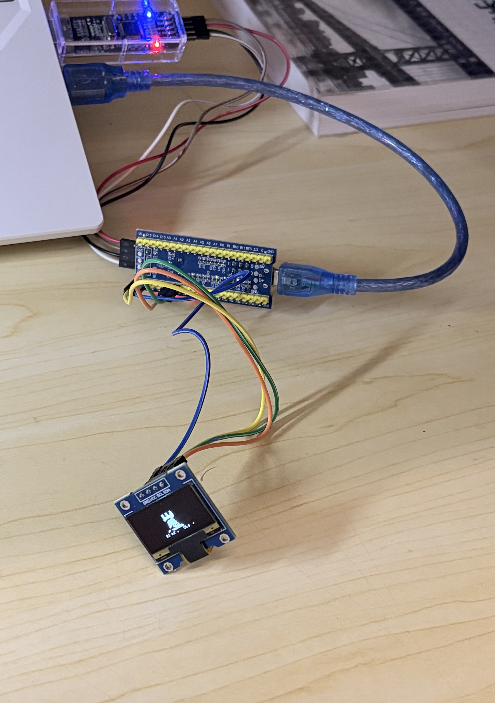
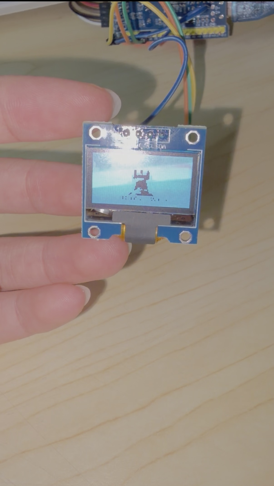

# STM32 Custom OLED Animation

This project drives a 0.96-inch I2C OLED (SSD1306) using an STM32F103C8T6. 

Instead of stopping at basic text display, I wrote a custom rendering function to display a full 128x64 bitmap and added a frame animation in the main loop. It currently runs entirely on a power bank without a PC connection.

## Hardware Connection

Connected using flying wires (no breadboard, for better stability).
- VCC -> 3.3V
- GND -> GND
- SCL -> PB6
- SDA -> PB7

## Result

The display boots up with the Rhodes Island logo. The `while(1)` loop toggles between normal and inverted display modes to create a blinking effect.

## How It Works

The core of this project is the `ShowPicture` function in `main.c`. 
I used `PCtoLCD2002` to generate the 1024-byte hex array for the 128x64 image. The function iterates through the array, parses the bits, and calls `OLED_DrawPoint` to paint each pixel directly into the screen's GRAM. 

The animation is simply a loop that redraws the image with `mode=1` (normal), delays, and redraws with `mode=0` (inverted).

## Build

1. Open `USER/OLED.uvprojx` in Keil MDK (v5).
2. Build (F7) and flash via DAP-Link (F8).
